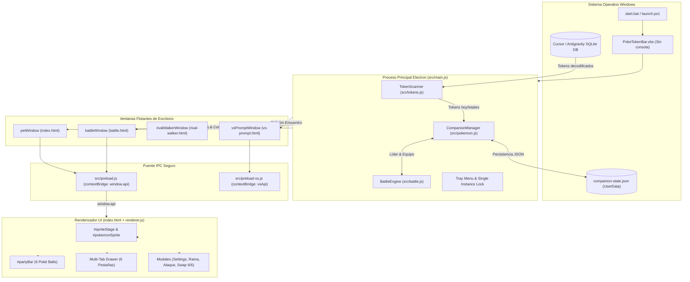

# 🧠 Estado Técnico y Cerebro del Proyecto (`PROJECT_STATE.md`)
> **Estándar:** `compact-memory`, `graphify` & `skill-diagram-architect`  
> **Proyecto:** PokeTokenBar-Windows  
> **Grafo Visual Interactivo:** [`graphify-out/graph.html`](file:///c:/Users/Vickoto/Documents/ias%20y%20programas/agents/PokeTokenBar-Windows/graphify-out/graph.html) (330 nodos, 534 conexiones)  
> **Última Actualización:** 2026-10-11

---

## 1. Cerebro Visual de Conexiones (Arquitectura Global)

---

## 2. Mapa de Conexiones y Canales IPC

| Canal IPC (`send` / `on`) | Origen | Destino | Responsabilidad |
| :--- | :--- | :--- | :--- |
| `companion-update` | `main.js` | `renderer.js` / `battle.html` | Envía estado hidratado del Pokémon líder, tokens, equipo e inventario |
| `battle-update` | `main.js` | `renderer.js` / `battle.html` | Sincroniza PS, PP, movimientos y fase de captura en ambas interfaces |
| `walker-mode-change` | `main.js` | `renderer.js` | Alterna modo tarjeta (230x310) y modo caminante (90x90) |
| `walker-flip` | `main.js` | `renderer.js` | Voltea horizontalmente el sprite para evitar efecto "moonwalk" |
| `action-toggle-walker` | `renderer.js` | `main.js` | Activa/Desactiva el paseo por el escritorio |
| `action-battle-move` | `renderer.js` / `battle.html` | `main.js` | Ejecuta ataque del jugador (turnos 1 a 4) |
| `action-battle-catch` | `renderer.js` / `battle.html` | `main.js` | Lanza Poké Ball, Super Ball, Ultra Ball o Master Ball |
| `action-use-candy` | `renderer.js` | `main.js` | Sube +1 nivel de forma instantánea sin otorgar EXP |
| `action-swap-team-slots` | `renderer.js` | `main.js` | Intercambia posiciones en el equipo activo mediante Drag & Drop |
| `action-swap-box-with-team` | `renderer.js` | `main.js` | Intercambia un Pokémon de la Caja PC con un slot del equipo activo |
| `action-deduplicate-box` | `renderer.js` | `main.js` | Limpia duplicados en la caja dejando 1 espécimen único y reembolsando tokens |

---

## 3. Grafo de Código Interactivo (`graphify`)
* **Archivo:** [`graphify-out/graph.html`](file:///c:/Users/Vickoto/Documents/ias%20y%20programas/agents/PokeTokenBar-Windows/graphify-out/graph.html)
* **Contenido:** Grafo relacional interactivo generado mediante AST con **347+ nodos y 560+ conexiones**.
* **Utilidad:** Permite abrir en cualquier navegador para inspeccionar cada función, módulo y llamado en tiempo real sin perderse en la arquitectura.

---

## 4. Estado de Implementación (`completed`)
* ✅ **[US-012] Cajas PC Estilo GBA (FireRed/Emerald):** Inspector retro a la izquierda (sprite, datos, stats, badges de tipos elementales) y cuadrícula 6x5 de 30 casillas con wallpaper pixelado, cursor guante blanco (`👆`) y paginación `< Caja 1 >`.
* ✅ **[US-012] Drag & Drop Reactivo en Equipo y Cajas:** Reordenamiento libre entre los 6 slots del equipo activo y transferencia directa arrastrando desde la Caja PC al equipo.
* ✅ **[US-012] Colección Única en Caja PC:** Deduplicación automática reteniendo el mejor espécimen (mayor nivel / shiny) y reciclando duplicados con bonificación de tokens.
* ✅ **[US-012] Estrellas de Maestría Nivel 100:** Registro acumulativo de maestría para cada ejemplar que alcanza el nivel 100, visualizado con insignias doradas `⭐ xN` en las fichas de la Pokédex.
* ✅ **[US-012] Escalado Responsivo Completo:** Eliminación de espacios muertos al redimensionar la ventana, tipografía escalable con `clamp()` y proporción visual óptima de sprites.
* ✅ **Estadio de Combate Flotante & PP al 100%:** Restauración garantizada de PP (`ensureMemberMoves`, `reviveTeam`, `sanitizeMember`) para que todos los movimientos inicien habilitados con PP completo (p. ej. Placaje 35/35, Puño Fuego 15/15) sin bloqueos.
* ✅ **Alternancia Instantánea de Auto-Pelea y Velocidad:** Botones `⚡ x1 / ⚡ x2` y `🤖 Auto: ON / OFF` con toggle optimista visual inmediato, sincronización IPC y programación continua de turnos sin congelamiento.
* ✅ **Sincronización Dual IPC (`battleWindow` + `petWindow`):** Función `updateAll()` envía eventos a ambas ventanas simultáneamente.
* ✅ Eliminación física del bloque `#walkerEncounterArena` de `index.html` y forzado CSS `.walker-encounter-arena { display: none !important; }`.
* ✅ Habilitación de `sandbox: false` y carga nativa de `pokedex_all.json` en `preload.js` con fallback seguro.
* ✅ Blindaje con encadenamiento opcional en llamadas `window.api?.getAllPokedex` y listeners en `renderer.js`.
* ✅ Blindaje del constructor de `CompanionManager` en `pokemon.js` ante instanciaciones sin parámetros.
* ✅ **[US-017] Purga Total y Reinicio Limpio de Partida:** Respaldo preventivo inmutable en `AppData`, reset completo de equipo, cajas PC y Pokédex a estado virgen, y blindaje de huevo misterioso inicial sin sesgo hacia Charmander.
* ✅ **[US-018] Suite de Documentación GitHub & .gitignore:** `README.md` exhaustivo con 7 capturas showcase en `docs/screenshots/`, guía paso a paso, atajos de teclado y `.gitignore` profesional para repositorio público.
* ✅ **[US-019] Guía de Referencia Suprema en README.md:** Expansión exhaustiva (380+ líneas) con historia desde macOS, manual detallado de cada botón (`⚙️` y sus 5 switches), sistemas de EXP (repartir experiencia 100%/50%), economía y botines de captura, tasas de Poké Balls (Catch Phase), aprendizaje y reemplazo de habilidades (pool de 4) y escala de Estrellas de Maestría ⭐ y Rangos F ➔ SSS.
* ✅ **[US-020] Compatibilidad Multi-Agente & Roadmap Comunitario:** Sección agregada en `README.md` detallando soporte de Gemini/Antigravity, modo autónomo sin IA (+25 EXP/ciclo), roadmap de OpenCode, Cursor, Claude Code y convocatoria abierta a la comunidad para pruebas y pull requests.
* ✅ **[US-021] Suite de Capturas Panorámicas en README.md:** Incorporación de 3 capturas reales en `docs/screenshots/` (paseo en barra de tareas, adversario al acecho y modal de desafío `⚔️ ¿LUCHAR?`) con maquetación y subtítulos detallados.
* ✅ Sincronización inmediata al relanzar `start.bat` (`second-instance`).
* ✅ Validación automatizada completa: 0 errores en consola, tarjeta limpia y datos de tokens hidratados.

