# ⚡ PokeTokenBar Windows

<div align="center">


**Tu Mascota Virtual Pokémon y Compañero de Escritorio para Gamers y Programadores.**  
*Convierte tu actividad diaria en la PC, líneas de código y tokens en una experiencia viva: incuba huevos, captura Pokémon salvajes, evoluciona a tu equipo y combate en un estadio flotante en tiempo real.*

[💡 Origen del Proyecto](#-origen-del-proyecto-y-evolución-desde-macos) • [✨ Características](#-características-principales) • [🎛️ Manual de Botones](#-manual-completo-de-botones-e-interfaz) • [📈 Guía de EXP](#-sistema-de-experiencia-exp-y-niveles-1-100) • [💰 Economía y Dinero](#-economía-del-juego-y-saldo-de-tienda) • [🔴 Capturas](#-sistema-de-capturas-y-poké-balls) • [⚔️ Habilidades](#-sistema-de-habilidades-ataques-y-reemplazo) • [🌟 Estrellas y Rangos](#-sistema-de-estrellas-rangos-f--sss-y-shinies) • [🤖 Agentes y Comunidad](#-compatibilidad-de-agentes--roadmap-comunitario) • [📦 Instalación](#-instalación-y-puesta-en-marcha) • [⌨️ Atajos](#-atajos-de-teclado-y-controles)

</div>


---

## 💡 Origen del Proyecto y Evolución desde macOS

### La Semilla: Un Widget Minimalista en Mac
El concepto original de **PokeTokenBar** nació como un pequeño proyecto de barra de menú (*Menu Bar Widget*) diseñado para **macOS**. Su único propósito era monitorear el consumo de tokens en **Cursor AI** mostrando un número y un sprite estático de Pokémon en la barra superior de Mac.

### La Gran Metamorfosis: Adaptación y Expansión Radical para Windows
Al portar este proyecto a **Windows 10/11** mediante **Electron**, decidimos que no debía ser un simple visor numérico pasivo, sino un **juego interactivo y compañero de escritorio completo** que elevara la experiencia a un nivel profesional:

| Característica | Concepto Original en macOS | Suite PokeTokenBar en Windows |
| :--- | :--- | :--- |
| **Entorno Visual** | Icono plano y estático en menú de Mac | **Mascota viva de escritorio (Desktop Pet)** con animaciones y física |
| **Pokédex** | Puñado limitado de sprites | **Pokédex Nacional completa de 1,025 especies (Gen 1 a Gen 9)** |
| **Almacenamiento** | Sin almacenamiento persistente | **Caja PC Retro estilo GBA (Rojo Fuego/Esmeralda)** con 30 casillas y Drag & Drop |
| **Combate** | Inexistente | **Estadio de Combate Flotante 1v1** con debilidades, velocidad x2 y auto-batalla |
| **Captura** | Inexistente | **Sistema de captura en vivo** con Poké, Super, Ultra y Master Balls |
| **Habilidades** | Sin ataques | **Pool de 4 movimientos oficiales** por nivel con modal de olvido y reemplazo |
| **Progresión** | Nivel básico lineal | **Estrellas de Maestría Nv. 100 ⭐** y **Escala de Rango F ➔ SSS (+50% stats)** |
| **Integración SO** | Limitada a la barra de Mac | **Aislamiento en Bandeja de Windows (System Tray)** y Modo Juego (`Ctrl+Shift+H`) |

---

## ✨ Características Principales

### 1. 🐣 Tarjeta del Compañero y HUD Multifunción
Controla a tu Pokémon líder en tiempo real. Visualiza su nivel, naturaleza, línea evolutiva, nivel máximo, barra de progreso a la siguiente fase y saldo de tokens de tienda. La barra superior contiene las 6 ranuras de Poké Balls de tu equipo activo con animación y brillo de selección.

<div align="center">
  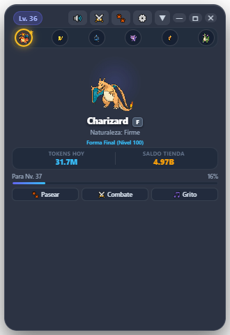
  <p><em>HUD compacto: Información del líder, equipo de 6 y balance de tokens</em></p>
</div>

---

### 2. 🐾 Modo Paseo Libre y Encuentros en el Escritorio (Desktop Pet)
Haz clic en **🐾 Pasear** o en el botón **`✕`** de la cabecera para que tu Pokémon baje al escritorio y comience a caminar libremente por tu pantalla.
* **Animación Fluida:** Pasos coordinados con detección de dirección y físicas naturales de movimiento.
* **Burbujas de Ánimo y Recompensas:** Emite notas musicales `🎶`, corazones `❤️` y notificaciones de ganancia de experiencia pasiva (+25 EXP por ciclo).
* **Física y Arrastre:** Puedes levantarlo y soltarlo con el mouse en cualquier rincón del monitor.
* **Doble Clic:** Abre inmediatamente la tarjeta completa sin interrumpir tus tareas.

---

#### 🚶‍♂️ A. Compañero Paseando en la Barra de Tareas
Al activar el paseo (o cerrar la tarjeta con **`✕`**), tu compañero recorre libremente la parte superior de la barra de tareas de Windows mientras programas, navegas o juegas:

<div align="center">
  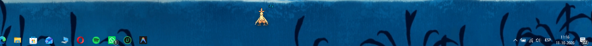
  <p><em>Paseo libre: Tu compañero recorre tu pantalla y barra de tareas acumulando experiencia pasiva</em></p>
</div>

---

#### 🌿 B. Aparición de Adversarios Salvajes al Acecho
Si tienes activados los encuentros salvajes en los ajustes o en el HUD (`⚔️`), Pokémon de cualquier generación y nivel (como este Corsola salvaje Nv. 37) aparecerán caminando a lo lejos por tu escritorio buscando a tu compañero:

<div align="center">
  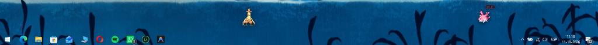
  <p><em>Encuentro salvaje: Un rival salvaje aparece al acecho en el horizonte de tu pantalla</em></p>
</div>

---

#### ⚔️ C. Encuentro Cara a Cara y Desafío Flotante (`⚔️ ¿LUCHAR?`)
Cuando ambos Pokémon se cruzan, se posicionan frente a frente y se despliega una tarjeta flotante interactiva con temporizador regresivo de 15 segundos: pulsa **`⚔️ Sí`** para abrir el Estadio Flotante e iniciar la batalla, o **`🏃 Huir`** para continuar tu paseo pacíficamente:

<div align="center">
  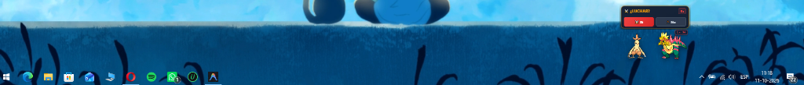
  <p><em>Cara a cara: Prompt flotante con opciones para saltar al Estadio de Combate o huir del encuentro</em></p>
</div>

---

### 3. 💾 Sistema de Caja PC Retro Estilo GBA (FireRed / Emerald)
Inspirado fielmente en los juegos clásicos de Game Boy Advance:
* **Inspector Retro a la Izquierda:** Al tocar cualquier Pokémon en la caja, su sprite animado se proyecta a la izquierda mostrando nivel, tipo elemental, PS actuales y ataque principal.
* **Cuadrícula 6x5 de 30 Casillas:** Fondo pixelado de hierba clásica con cursor de guante blanco y paginación rápida (`< Caja 1 >`, `< Caja 2 >`).
* **Filtros por Región y Caja VIP:** Filtra instantáneamente por Kanto, Johto, Hoenn, Sinnoh, Teselia, Kalos, Alola, Galar, Paldea o **✨ Caja Shiny**.
* **Drag & Drop Bidireccional:** Arrastra cualquier Pokémon de la caja directamente a las 6 ranuras de tu equipo activo o viceversa.
* **Deduplicación Automática (`Limpiar Duplicados`):** Detecta clones repetidos, conserva el ejemplar de mayor nivel o Shiny, y recicla los sobrantes en **Esencia de Especie** y reembolso de tokens.

<div align="center">
  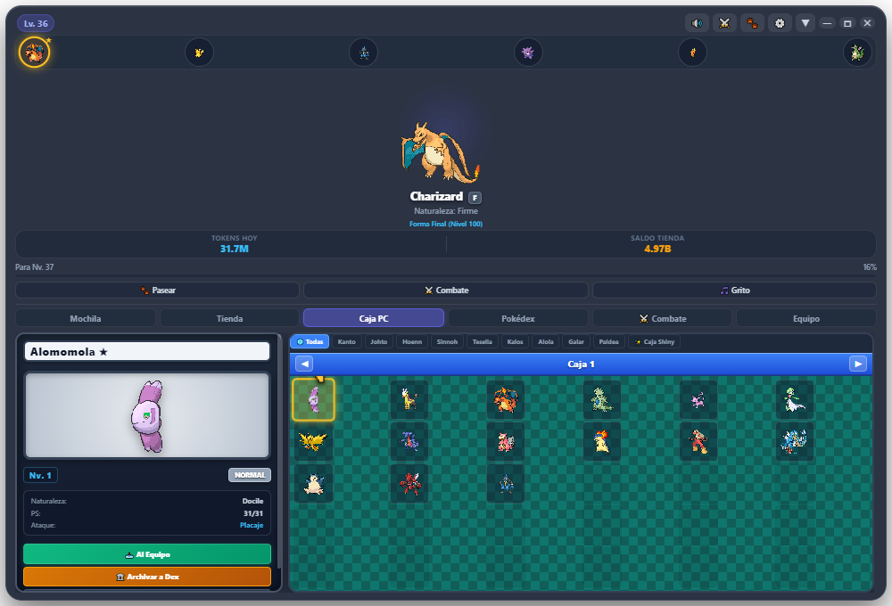
  <p><em>Caja PC Retro: 30 casillas por caja, inspector visual y drag & drop de equipo</em></p>
</div>

---

### 4. 📖 Pokédex Nacional Completa (1,025 Pokémon - 9 Generaciones)
Toda la historia de Pokémon en una sola pantalla:
* Pestañas por región con rangos oficiales:
  * **Kanto** (#001 - #151)
  * **Johto** (#152 - #251)
  * **Hoenn** (#252 - #386)
  * **Sinnoh** (#387 - #493)
  * **Teselia / Unova** (#494 - #649)
  * **Kalos** (#650 - #721)
  * **Alola** (#722 - #809)
  * **Galar** (#810 - #898)
  * **Paldea** (#899 - #1025)
* **Siluetas de Misterio:** Las especies no capturadas se muestran como elegantes siluetas oscuras con `#???`.
* **Reclutamiento Rápido:** Botón `+ Equipo` en cada Pokémon descubierto para integrarlo a tu formación.

<div align="center">
  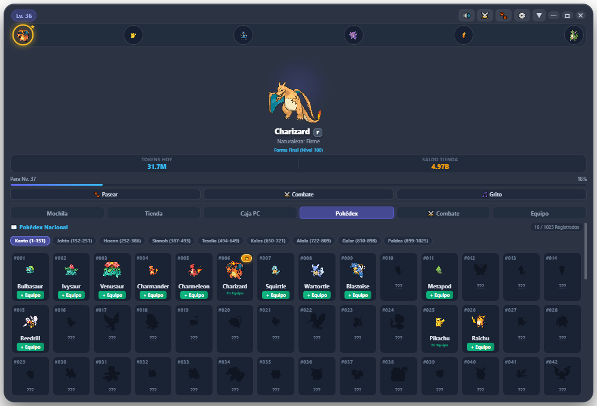
  <p><em>Pokédex Nacional: 1,025 especies distribuidas en 9 regiones con siluetas y registro activo</em></p>
</div>

---

### 5. 🔬 Ficha Técnica Detallada (Offline-First + Rangos F ➔ SSS)
Al hacer clic en cualquier Pokémon registrado en la Pokédex, se abre su ficha técnica completa:
* **Estadísticas Base:** Barras de PS, Ataque, Defensa y Velocidad con el Total de Puntos Base (BST).
* **Datos Oficiales:** Altura, peso, habilidad especial y texto de descripción oficial (flavor text).
* **Escala de Potencial e IVs (F ➔ SSS):** Aumenta el rango consumiendo Esencia de Especie para otorgar hasta **+50% de bonus** a todas sus estadísticas en batalla.
* **100% Offline-First:** Toda la base reside localmente en `src/pokedex_all.json`. Si no hay internet, funciona sin interrupciones.

<div align="center">
  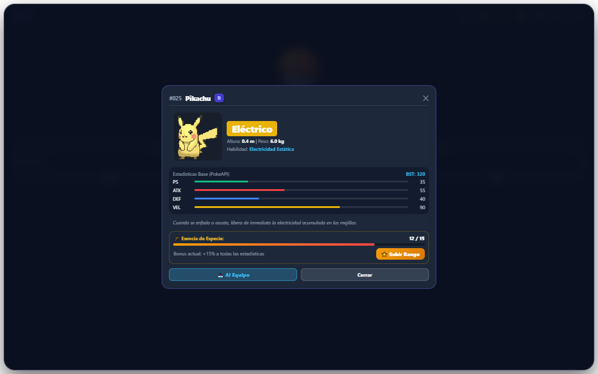
  <p><em>Ficha Técnica: Estadísticas BST, descripción oficial y sistema de Rango de Potencial F ➔ SSS</em></p>
</div>

---

### 6. ⚔️ Estadio de Combate Flotante en Tiempo Real
Una ventana independiente (`battle.html`) dedicada a batallas por turnos de ritmo ágil:
* **4 Movimientos con PP y Tipos:** Multiplicadores elementales (Superficaz x2, Poco eficaz x0.5, Inmunidades x0).
* **Captura en Vivo (`🔴 Capturar`):** Arroja Poké Balls con porcentajes reales de captura.
* **Modo Automático y Velocidad:** Botones `⚡ x1 / ⚡ x2` y `🤖 Auto: ON / OFF` para entrenar a tu equipo mientras trabajas.

<div align="center">
  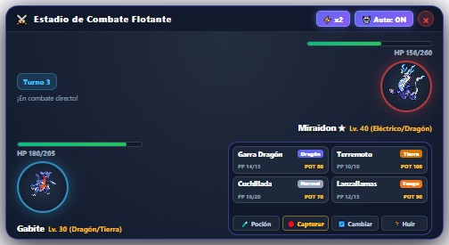
  <p><em>Estadio Flotante: Combates 1v1 con ataques por turnos, captura de Poké Balls y modo automático</em></p>
</div>

---

### 7. 🎒 Tienda de Objetos y Mochila
Gasta los tokens obtenidos con tu actividad en la PC:
* **Poké Balls:** Packs de Poké Balls, Super Balls, Ultra Balls y Master Balls.
* **Pociones:** Restaura los PS de tu equipo tras combates intensos.
* **Caramelos Raros:** Sube +1 nivel de forma inmediata.
* **Mentas de Naturaleza:** Modifica la naturaleza de tu compañero para optimizar su estilo de combate.
* **Huevos Misteriosos:** Adquiere huevos de rareza Común, Infrecuente y Rara para incubar nuevas especies.

<div align="center">
  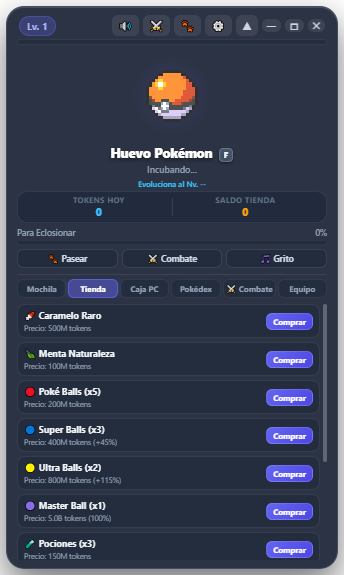
  <p><em>Tienda: Adquiere suministros de captura, caramelos raros y huevos con tus tokens</em></p>
</div>

---

## 🎛️ Manual Completo de Botones e Interfaz

### 1. Barra Superior de la Tarjeta (Header Controls)
| Botón / Icono | Nombre | Función Detallada |
| :---: | :--- | :--- |
| **`🔊 / 🔇`** | **Sonido y Rugidos** | Alterna entre silenciar o reproducir los gritos oficiales de los Pokémon y los efectos de audio. |
| **`⚔️`** | **Encuentros Rápidos** | Activa o desactiva la aparición de Pokémon salvajes mientras tu compañero camina en el escritorio. |
| **`🐾`** | **Modo Paseo Libre** | Oculta la tarjeta y baja al Pokémon al escritorio para que camine libremente. |
| **`⚙️`** | **Ajustes del Juego** | Abre el **Modal de Ajustes** para configurar las opciones del juego en detalle (ver sección abajo). |
| **`▼ / ▲`** | **Cajón de Pestañas** | Despliega o repliega las 6 pestañas inferiores: Mochila, Tienda, Caja PC, Pokédex, Combate y Equipo. |
| **`—`** | **Minimizar** | Oculta la tarjeta directamente a la bandeja de iconos ocultos de Windows (System Tray). |
| **`🗖`** | **Maximizar / Restaurar** | Agranda la tarjeta al tamaño de tu monitor con escalado adaptativo de sprites e inspector gigante. |
| **`✕`** | **Cerrar a Paseo** | Cierra la ventana visual y envía a tu Pokémon a pasear por el escritorio en segundo plano sin matar el proceso. |

---

### 2. El Engranaje de Ajustes (`⚙️`) en Detalle
Al pulsar el botón **`⚙️`**, se despliega el panel de configuración avanzada con 5 interruptores interactivos y una herramienta de mantenimiento:

1. **🐾 Encuentros Salvajes (ON / OFF):**  
   Controla si los rivales salvajes pueden aparecer caminando por tu monitor para retarte a un duelo. Si necesitas máxima concentración o estás en una videollamada, apágalo para disfrutar de un paseo 100% seguro y sin interrupciones.
2. **⚡ Omitir Diálogo VS (ON / OFF):**  
   Al activarse, salta la ventana previa de confirmación del encuentro (*"¡Un Pokémon salvaje apareció!"*) y entra de forma directa y fluida al combate automático.
3. **🎒 Poké Balls Especiales en Auto (ON / OFF):**  
   Autoriza a la inteligencia artificial del combate a lanzar Super Balls o Ultra Balls si te quedas sin Poké Balls estándar durante batallas automáticas.
4. **🔊 Sonido y Rugidos (ON / OFF):**  
   Interruptor maestro para activar o desactivar todos los aullidos, efectos de sonido y gritos de batalla.
5. **🎮 Ocultar en Juegos / Pantalla Completa (ON / OFF):**  
   Sincronizado con el atajo de teclado **`Ctrl + Shift + H`**. Oculta instantáneamente todas las ventanas mientras juegas o miras películas sin detener el escaneo de tokens ni la acumulación de experiencia pasiva.
6. **🔧 Botón Sincronizar / Reparar Equipo:**  
   Herramienta de auto-sanación instantánea. Si sufres algún corte de energía o error de sincronización, este botón restaura los PP al 100%, purga referencias huérfanas, rehidrata los datos de la base local y sincroniza la tarjeta al instante.

---

### 3. Botones de Acción Rápida (Bajo la Barra de EXP)
* **`🐾 Pasear`:** Transforma la tarjeta en la mascota libre de escritorio.
* **`⚔️ Combate`:** Abre el Estadio Flotante de Combate 1v1 para iniciar un duelo.
* **`🎵 Grito`:** Reproduce en vivo el rugido oficial del Pokémon líder.

---

### 4. Botones de la Caja PC
* **`📥 Al Equipo`:** Despliega al Pokémon seleccionado de la caja a tu equipo de 6. Si el equipo está lleno, abre el modal de sustitución para elegir a quién reemplazar.
* **`🏛️ Archivar a Dex`:** Si el Pokémon alcanzó el Nivel 100, se archiva de forma definitiva y permanente otorgando la **Estrella Dorada de Maestría ⭐** a la especie en la Pokédex. Si es de menor nivel, libera la casilla y premia con Esencia.
* **`🧹 Limpiar Duplicados`:** Analiza las 30 casillas de la caja, conserva el espécimen de mayor nivel o Shiny, y recicla automáticamente los clones repetidos en **Esencia de Especie + Dinero reembolsado**.

---

### 5. Controles del Estadio de Combate Flotante (`battle.html`)
* **`⚡ x1 / ⚡ x2`:** Alterna entre velocidad de animación estándar y velocidad turbo x2.
* **`🤖 Auto: ON / OFF`:** Activa la IA que selecciona automáticamente el ataque más eficaz según ventajas elementales.
* **`🧪 Poción`:** Consume 1 poción del inventario y restaura los PS de tu compañero en pleno combate.
* **`🔴 Capturar`:** Despliega la consola de Poké Balls con los porcentajes exactos de captura en vivo.
* **`🔄 Cambiar`:** Abre la banca de tu equipo activo para relevar al compañero en batalla.
* **`🏃 Huir`:** Escapa del combate salvaje sin penalización.

---

## 📈 Sistema de Experiencia (EXP) y Niveles 1-100

¿Cómo crecen y suben de nivel tus Pokémon? PokeTokenBar cuenta con múltiples canales sinérgicos de progreso:

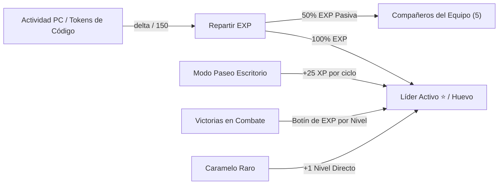

1. **Tokens de Actividad y Repartir Experiencia (EXP Share):**
   * **Líder del Equipo (100% EXP):** La ranura activa marcada con el halo dorado recibe la totalidad de la experiencia convertida de tu trabajo diario:
     $$\text{EXP Ganada} = \frac{\Delta \text{Tokens}}{150}$$
   * **Huevos en Incubación (100% Progreso):** Si tienes un huevo en incubación, absorbe el 100% de los tokens hasta alcanzar el umbral de eclosión (**500,000 tokens** en modo rápido). Al llegar al 100%, eclosiona en un Pokémon de Nivel 5 con ataques completos.
   * **Compañeros del Equipo (50% EXP Pasiva):** Los otros 5 miembros del equipo se benefician del sistema *EXP Share*, absorbiendo pasivamente la mitad de la experiencia sin necesidad de combatir.
2. **EXP Pasiva de Escritorio (Modo Paseo):**
   * Mientras tu Pokémon deambula por el escritorio mientras navegas o trabajas, gana **+25 XP pasiva periódica** por cada ciclo de caminata.
3. **Victorias en el Estadio de Combate:**
   * Al vencer a un rival salvaje en el Estadio Flotante, se otorga un botín masivo de EXP proporcional al nivel y estadísticas del oponente. El Pokémon que combatió se lleva el 100% y el resto del equipo el 50%.
4. **Caramelos Raros:**
   * Puedes consumir Caramelos Raros desde la Mochila para otorgar **+1 Nivel instantáneo** sin necesidad de acumular puntos de experiencia (válido hasta Nivel 100).

---

## 💰 Economía del Juego y Saldo de Tienda

El sistema económico te premia por tu actividad y tus logros como entrenador:

$$\text{Saldo Gastable} = \text{Total Tokens Actividad} + \text{Bonus Money (Premios)} - \text{Tokens Gastados}$$

### 1. ¿Cómo se Gana el Dinero?
1. **Actividad Continua en la PC:** Cada token registrado por el escáner de desarrollo se suma a tu saldo para gastar en la tienda.
2. **Botín en Efectivo por Captura Exitosa:**
   * Al capturar con éxito a un Pokémon salvaje en el Estadio de Combate, recibes una bonificación de dinero en efectivo:
     $$\text{Recompensa en Dinero} = (\text{Nivel del Rival} \times \$250,000) + \$1,000,000$$
     * *Ejemplo 1:* Capturar un rival Lv. 10 te premia con **+$3,500,000**.
     * *Ejemplo 2:* Capturar un rival Lv. 40 te premia con **+$11,000,000** de saldo inmediato.
3. **Reciclaje de Clones y Deduplicación (`[🧹 Limpiar Duplicados]`):**
   * Al limpiar la caja, cada clon duplicado se recicla otorgando un **reembolso directo en tokens** más **1 Esencia de especie** para subir su rango competitivo.

---

## 🔴 Sistema de Capturas y Poké Balls

Encuentra Pokémon salvajes y atrápalos para completar tu Pokédex y reforzar tu equipo:

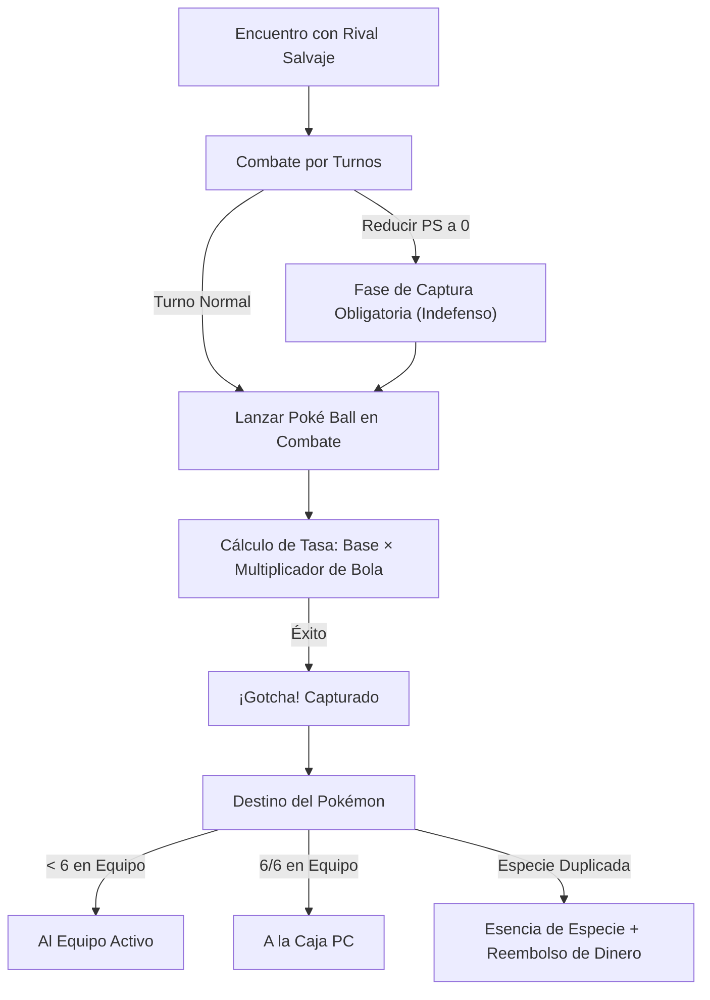

### 1. Tasas Base de Captura por Rareza
* **Especies Comunes:** 65% probabilidad base.
* **Especies Raras y Starters:** 42% probabilidad base.
* **Especies Legendarias y Singulares:** 22% probabilidad base.

### 2. Catálogo y Multiplicadores de Poké Balls
* 🔴 **Poké Ball:** Multiplicador **x1.0**. Económica y balanceada para especies comunes.
* 🔵 **Super Ball:** Multiplicador **x1.45** (+45% de efectividad de captura).
* 🟡 **Ultra Ball:** Multiplicador **x2.15** (+115% de efectividad). Recomendada para evoluciones finales y Pokémon raros.
* 🟣 **Master Ball:** **100% de éxito garantizado**. Nunca falla, sin importar la especie, nivel o vida del rival.

### 3. Fase de Captura Obligatoria (*Catch Phase*)
Puedes lanzar una Poké Ball en cualquier momento del combate, o bien combatir hasta reducir los PS del rival a cero. Al caer debilitado, el rival no desaparece inmediatamente: entra en la **Fase de Captura**, quedando indefenso para que lances tus bolas con total seguridad o presiones *Dejar ir* para cobrar el botín de EXP.

---

## ⚔️ Sistema de Habilidades, Ataques y Reemplazo

### 1. Pool de 4 Movimientos Oficiales
Cada Pokémon puede equipar simultáneamente un máximo de **4 movimientos de combate**. Cada ataque cuenta con:
* **Nombre oficial** (Placaje, Ascuas, Lanzallamas, Terremoto, Garra Dragón, etc.).
* **Tipo elemental** (Fuego, Agua, Planta, Eléctrico, Dragón, etc.).
* **Potencia base (POT)**.
* **Puntos de Poder (PP)**: Contador de usos disponibles (ej. Placaje 35/35, Lanzallamas 15/15).

### 2. Modal de Aprendizaje y Reemplazo de Ataques
Al subir de nivel o evolucionar, el Pokémon consulta su árbol canónico de movimientos en PokéAPI:
* Si tiene menos de 4 ataques, **aprende el nuevo movimiento automáticamente** con PP completo.
* Si ya conoce 4 movimientos, la interfaz despliega el **Modal de Aprendizaje de Ataques**:
  1. Muestra el nuevo movimiento desbloqueado con su tipo y potencia.
  2. Lista los 4 ataques actuales del Pokémon con un botón individual **`Olvidar`**.
  3. Al pulsar `Olvidar`, el movimiento seleccionado se sustituye por el nuevo ataque.
  4. Si prefieres conservar tu set actual, presiona **`No Aprender Ahora`**.

---

## 🌟 Sistema de Estrellas, Rangos (F ➔ SSS) y Shinies

### 1. ⭐ Estrellas Doradas de Maestría (Nivel 100)
* Cuando un Pokémon alcanza el nivel máximo (**Nivel 100**), puedes consagrarlo transfiriéndolo desde la Caja PC con el botón **`[🏛️ Archivar a Dex]`**.
* Al archivarlo, la casilla de la caja se libera y la especie queda condecorada permanentemente con la **Estrella Dorada de Maestría ⭐** en la Pokédex Nacional (`⭐ x1`, `⭐ x2`, etc. de forma acumulativa).

### 2. 🧬 Rangos de Potencial e IVs (F ➔ SSS)
Cada especie cuenta con una escala de potencial competitivo de 9 rangos que otorga bonificaciones porcentuales permanentes a **todas sus estadísticas base (PS, Ataque, Defensa y Velocidad)**:

| Rango | Bonus de Stats | Costo en Esencia de Especie |
| :---: | :---: | :---: |
| **F** | +0% | Inicial |
| **E** | +3% | 1 Esencia |
| **D** | +6% | 2 Esencias |
| **C** | +10% | 4 Esencias |
| **B** | +15% | 8 Esencias |
| **A** | +22% | 15 Esencias |
| **S** | +30% | 25 Esencias |
| **SS** | +40% | 40 Esencias |
| **SSS** | **+50% (MÁXIMO)** | 60 Esencias |

* **¿Cómo obtener Esencia?** Capturando ejemplares duplicados o usando el botón `[🧹 Limpiar Duplicados]` en la Caja PC.
* **¿Cómo subir de rango?** Abre la **Ficha Técnica** del Pokémon en la Pokédex y pulsa **`[⭐ Subir Rango]`**.

### 3. ★ Pokémon Variocolor (Shiny)
* **Probabilidad Base:** 1 entre 64 eclosiones o capturas.
* **Amuleto Iris:** Al comprar el *Amuleto Iris* en la Tienda, la probabilidad mejora a **1 entre 48**.
* **Distintivos:** Insignia brillante `★ SHINY`, paleta de color alternativa oficial y filtro exclusivo en la Caja PC (`✨ Caja Shiny`).

---

## 🚀 Requisitos del Sistema

* **Sistema Operativo:** Windows 10 o Windows 11 (64-bit).
* **Entorno de Ejecución:** [Node.js](https://nodejs.org/) v18.0.0 o superior (recomendado Node.js LTS).

---

## 📦 Instalación y Puesta en Marcha

### Paso 1: Clonar el Repositorio
```bash
git clone https://github.com/tu-usuario/PokeTokenBar-Windows.git
cd PokeTokenBar-Windows
```

### Paso 2: Instalar Dependencias
```bash
npm install
```

### Paso 3: Iniciar la Aplicación
Tienes varias formas sencillas de iniciar:

1. **Método Recomendado (Doble Clic):**
   * Haz doble clic en **`start.bat`** (inicia el entorno en segundo plano sin ventanas molestas de terminal).
2. **Desde la Consola:**
   ```bash
   npm start
   ```
3. **Reiniciar el juego:**
   * Haz doble clic en **`reiniciar.bat`** para cerrar cualquier proceso previo y levantar una instancia fresca sincronizada.

---

## ⌨️ Atajos de Teclado y Controles

| Control / Atajo | Dónde se usa | Acción |
| :--- | :--- | :--- |
| **`Ctrl + Shift + H`** | Global (Cualquier app) | Oculta / Muestra todas las ventanas (Modo Juego) |
| **Doble Clic** | Compañero Caminante | Alterna entre Modo Paseo y Tarjeta HUD principal |
| **Arrastrar con Mouse** | Cualquier Ventana | Mueve libremente las ventanas flotantes por tu monitor |
| **Arrastrar Pokémon** | Caja PC ➔ Equipo | Cambia un miembro de la formación arrastrándolo al slot |
| **Arrastrar Pokémon** | Equipo ➔ Equipo | Reordena las posiciones y líder de tus 6 Pokémon |
| **Clic Derecho en Tray** | Barra de Tareas (Reloj) | Menú contextual: Mostrar/Ocultar, Combate, Salir |
| **`⚡ x1 / ⚡ x2`** | Estadio de Combate | Alterna la velocidad de las animaciones y turnos |
| **`🤖 Auto: ON / OFF`** | Estadio de Combate | Activa/Desactiva la selección automática de ataques |

---

## 📂 Estructura del Proyecto

```plaintext
PokeTokenBar-Windows/
├── docs/
│   └── screenshots/              # Capturas oficiales de alta resolución para la documentación
│       ├── 01_hud_principal.png
│       ├── 02_paseo_escritorio.png
│       ├── 03_caja_pc_gba.png
│       ├── 04_pokedex_nacional.png
│       ├── 05_ficha_pokedex_modal.png
│       ├── 06_estadio_combate.png
│       └── 07_tienda_y_mochila.png
├── src/
│   ├── main.js                   # Proceso Principal de Electron (Ventanas, IPC, Tray, Atajos)
│   ├── preload.js                # Puente seguro ContextBridge para index.html y battle.html
│   ├── preload-vs.js             # Puente seguro para la ventana de colisión de encuentro
│   ├── pokemon.js                # CompanionManager: Mecánicas de EXP, Cajas PC, Dex, Huevos
│   ├── battle.js                 # BattleEngine: Motor de combate por turnos, daño, captura
│   ├── moves.js                  # Catálogo de movimientos, PP, tipos y poderes base
│   ├── tokens.js                 # TokenScanner: Lector y acumulador de actividad
│   ├── index.html                # Ventana principal del compañero, Caja PC y Pokédex
│   ├── renderer.js               # Lógica interactiva de UI, animaciones y Drag & Drop
│   ├── battle.html               # Estadio de Combate flotante independiente
│   └── pokedex_all.json          # Base de datos offline de las 1,025 especies de Pokémon
├── .gitignore                    # Filtro de seguridad que excluye pruebas, logs y datos locales
├── package.json                  # Manifiesto de dependencias y scripts de ejecución
├── start.bat                     # Lanzador rápido en Windows (sin ventana de consola)
├── reiniciar.bat                 # Reiniciador automático de procesos
├── CHANGELOG_AGENTS.md           # Bitácora histórica detallada de versiones y refactorizaciones
├── PROJECT_STATE.md              # Estado arquitectónico y mapa de dependencias
└── README.md                     # Documentación oficial del proyecto
```

---

## 🛡️ Almacenamiento y Persistencia de Partida

* Todos los datos de tu progreso (equipo, Pokémon capturados, cajas PC, saldo de tokens e historial) se guardan de forma segura y local en:
  ```plaintext
  %APPDATA%\poketokenbar-windows\companion-state.json
  ```
* **Privacidad Total:** Tu progreso nunca se sube a servidores externos ni a la nube sin tu consentimiento.
* **Respaldo Manual:** Puedes copiar el archivo `companion-state.json` en cualquier momento para respaldar tu partida o transferirla a otra computadora.

---

## 🤖 Compatibilidad de Agentes & Roadmap Comunitario

### 🔍 ¿Qué asistentes y agentes son compatibles actualmente?
* 🟢 **Google Antigravity IDE / Gemini CLI:** Soporte nativo integrado en `src/tokens.js`. Lee en tiempo real las bases de datos locales SQLite (`~/.gemini/.../conversations`) decodificando los tokens de entrada, salida y caché del modelo.
* 🎮 **Modo Autónomo / Sin Agente:** Si no utilizas ningún asistente de IA o programas sin agentes, el juego funciona al **100% de manera autónoma**:
  * Ganancia pasiva de **+25 EXP por ciclo de paseo** de tu compañero de escritorio.
  * Encuentros salvajes aleatorios mientras usas tu PC.
  * Victorias y recompensas monetarias en el Estadio de Combate.
  * Incubación de huevos por tiempo y pasos.

---

### 🔮 Roadmap: Compatibilidad Futura con Otros Agentes
Estamos expandiendo activamente la arquitectura de `TokenScanner` para convertir PokeTokenBar en un hub universal de telemetría para programadores. En **futuras versiones y actualizaciones**, incorporaremos compatibilidad nativa con:
* ⏳ **OpenCode** (CLI y entornos de desarrollo)
* ⏳ **Cursor AI** (lectura de estado y telemetría de sesiones `state.vscdb`)
* ⏳ **Claude Code / Anthropic CLI**
* ⏳ **GitHub Copilot / Roo Code / Cline**
* ⏳ **Modelos Locales (Ollama, LM Studio, Jan)**

---

### 🧪 ¡Únete al Proyecto y Ayúdanos con los Tests!
¿Utilizas **OpenCode**, **Cursor**, **Claude** u otro agente de desarrollo en tu día a día y quieres ayudar a testear o programar el adaptador para tu herramienta favorita?

**¡Toda la comunidad es bienvenida a participar!** Necesitamos apoyo para realizar pruebas de lectura de telemetría en diferentes entornos y configuraciones:
1. **Fork del Repositorio:** Haz un fork del proyecto en tu cuenta de GitHub.
2. **Crea tu Rama:** `git checkout -b feature/opencode-telemetry-test`
3. **Prueba y Adapta:** Ayúdanos a identificar las rutas y formatos donde tu agente guarda los consumos de tokens o a implementar nuevos adaptadores en `src/tokens.js`.
4. **Envía tu Pull Request / Reporta:** Abre un PR con tus hallazgos o comparte tus pruebas y sugerencias abriendo un **Issue** en GitHub.

¡Juntos haremos de PokeTokenBar el compañero de escritorio definitivo para todos los desarrolladores!

---

## 🤝 Créditos y Licencia

* **Sprites y Animaciones:** Agradecimientos especiales a [Pokémon Showdown](https://play.pokemonshowdown.com/) y la comunidad de [PokeAPI](https://pokeapi.co/) por proveer los recursos gráficos oficiales en formato GIF y PNG.
* **Propiedad Intelectual:** Pokémon y los nombres de las especies son marcas registradas de Nintendo, Game Freak y Creatures Inc. Este software es un proyecto sin fines de lucro creado con fines educativos y recreativos para fanáticos.
* **Licencia de Código:** Distribuido bajo la Licencia [MIT](LICENSE).

---

<div align="center">
  <sub>Desarrollado con 💖 por Vickoto Aguilera para la comunidad de desarrolladores y entrenadores Pokémon. (Versión de prueba y verificación)</sub>
</div>
